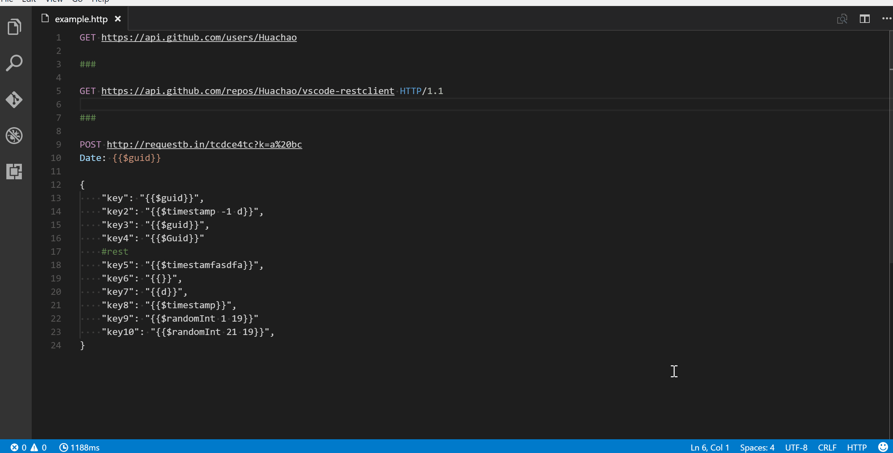
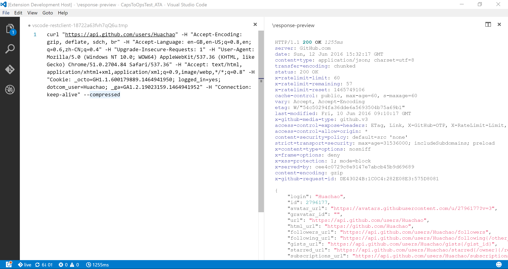
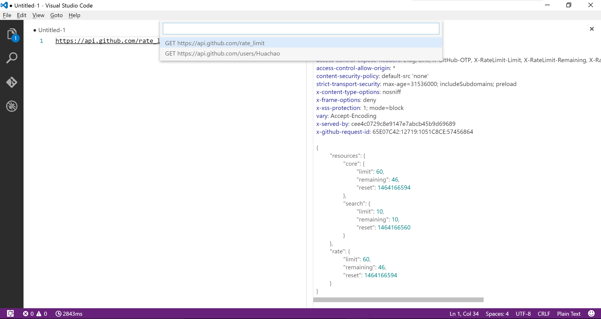
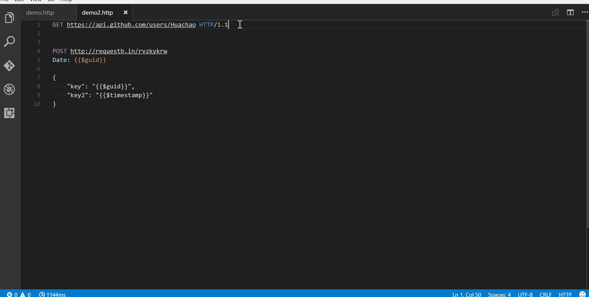
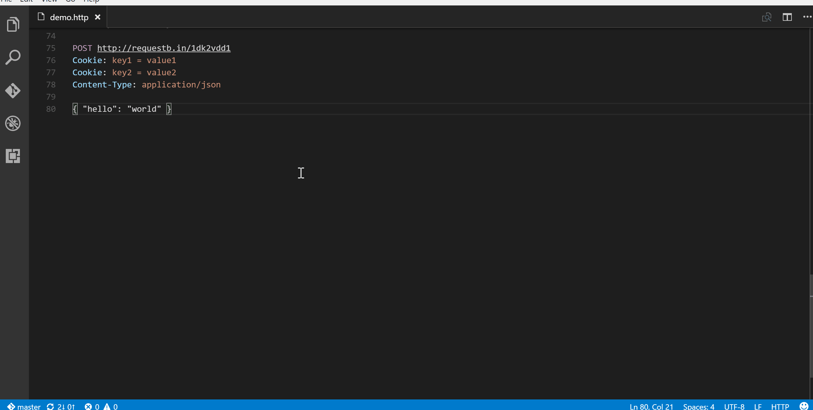
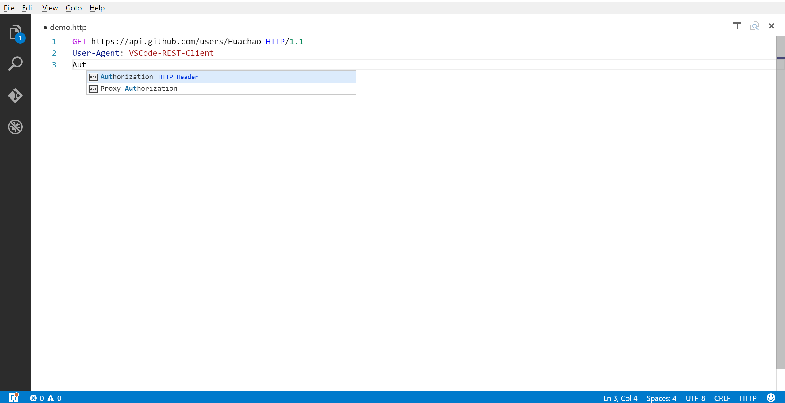
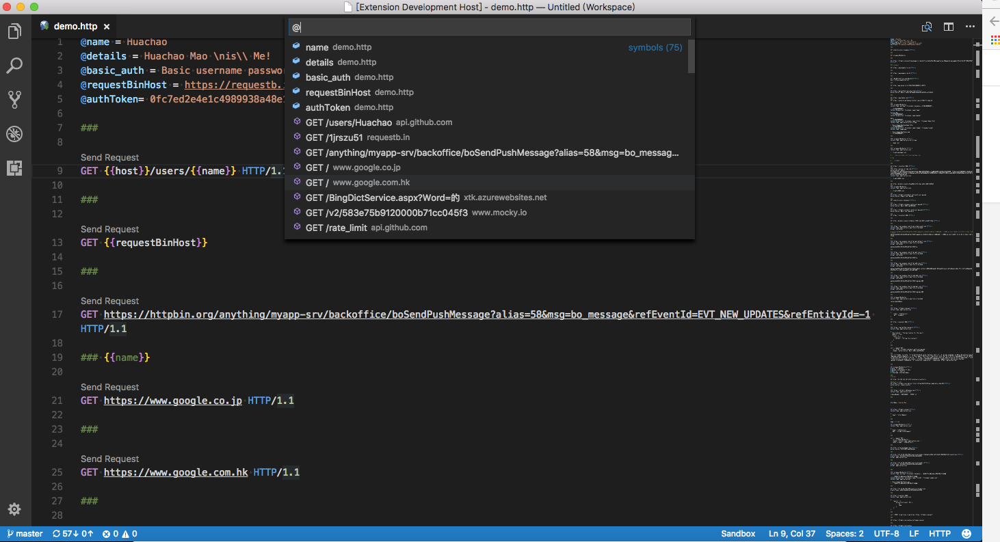

# REST Client CE

**Send HTTP requests from a `.http` file and read the response in Visual Studio Code.** No account, no cloud, no paywall, no telemetry.

REST Client was created by [Huachao Mao](https://github.com/Huachao) and reached 7.5 million installs. Its last release was 0.25.1 in June 2022. Since August 2026 it is maintained here, by the [vscode-restclient organisation](https://github.com/vscode-restclient), on the same code and the same `.http` format, under the same MIT license. Everything below still works exactly as Huachao documented it; this README is his, kept as it was, with a short summary of what changed first. The only edit to his text is the _AWS Cognito_ entry: the extension has supported it for years, but the original README never mentioned it.

## What is new since 0.25.1

Full details in the [CHANGELOG](CHANGELOG.md); the longer story, with screenshots, in [docs/HTTPKEEPER.md](docs/HTTPKEEPER.md).

- **Fake data**: `{{$faker internet.email}}` — any [Faker](https://fakerjs.dev) module, lazily loaded, same syntax as rest-client-next.
- **A test suite** (125 tests: 79 unit and 46 integration, run inside a real VS Code), **0 vulnerabilities** in production dependencies (from 75), **400 packages** (from 1,487), **telemetry removed**.
- **Bugs fixed**: the response not showing up in Cursor, a re-sent request with mangled headers, a JSONPath with several matches returning only the first, XPath request variables.
- **A terminal runner** for CI (`npx @vscode-restclient/cli api.http`, `--junit`, GitHub Action) that **runs a whole file in order**, with later requests using earlier responses, and checks **assertions written in the file** (`# @assert status == 200`). In the editor, Send Request shows the verdict of the assertions under the response.
- **The JetBrains format, complete**: `http-client.env.json` / `http-client.private.env.json`, `import ./other.http`, `run #name`, request variables across files, `{{$secret NAME}}`, `{{$uuid}}`, `{{$isoTimestamp}}`, `{{$random.integer(min,max)}}`.
- **Streaming**: `text/event-stream` painted as it arrives; `WEBSOCKET` requests.
- **The `QUERY` method** ([draft-ietf-httpbis-safe-method-w-body](https://www.ietf.org/archive/id/draft-ietf-httpbis-safe-method-w-body-05.html)): safe and idempotent like `GET`, but with a request body — highlighting, completion, snippet and terminal runner included.
- **Tools for agents**: language-model tools in VS Code and an MCP server (`restclient mcp`).
- The interface is available in English and Spanish.

Your `rest-client.*` settings, history, cookies and environments keep working unchanged.

---

## Main Features

- Send/Cancel/Rerun **HTTP request** in editor and view response in a separate pane with syntax highlight
- Send **GraphQL query** and author **GraphQL variables** in editor
- Send **cURL command** in editor and copy HTTP request as `cURL command`
- Auto save and view/clear request history
- Compose _MULTIPLE_ requests in a single file (separated by `###` delimiter)
- View image response directly in pane
- Save raw response and response body only to local disk
- Fold and unfold response body
- Customize font(size/family/weight) in response preview
- Preview response with expected parts(_headers only_, _body only_, _full response_ and _both request and response_)
- Authentication support for:
  - Basic Auth
  - Digest Auth
  - SSL Client Certificates
  - Azure Active Directory v2  (v1 deprecated since 2023 was removed, use v2 instead)
  - OIDC
  - Microsoft Identity Platform
  - AWS Signature v4
  - AWS Cognito
- Environments and custom/system variables support
  - Use variables in any place of request(_URL_, _Headers_, _Body_)
  - Support **environment**, **file**, **request** and **prompt** custom variables
  - Interactively assign **prompt** custom variables per request
  - Auto completion and hover support for both **environment**, **file** and **request** custom variables
  - Diagnostic support for **request**, **file** and **prompt** custom variables
  - Go to definition support for **request** and **file** custom variables
  - Find all references support _ONLY_ for **file** custom variables
  - Provide system dynamic variables
    - `{{$guid}}`
    - `{{$randomInt min max}}`
    - `{{$timestamp [offset option]}}`
    - `{{$datetime rfc1123|iso8601 [offset option]}}`
    - `{{$localDatetime rfc1123|iso8601 [offset option]}}`
    - `{{$processEnv [%]envVarName}}`
    - `{{$dotenv [%]variableName}}`
  - Easily create/update/delete environments and environment variables in setting file
  - File variables can reference both custom and system variables
  - Support environment switch
  - Support shared environment to provide variables that available in all environments
- Generate code snippets for **HTTP request** in languages like `Python`, `JavaScript` and more!
- Remember Cookies for subsequent requests
- Proxy support
- Send SOAP requests, as well as snippet support to build SOAP envelope easily
- `HTTP` language support
  - `.http` and `.rest` file extensions support
  - Syntax highlight (Request and Response)
  - Auto completion for method, url, header, custom/system variables, mime types and so on
  - Comments (line starts with `#` or `//`) support
  - Support `json` and `xml` body indentation, comment shortcut and auto closing brackets
  - Code snippets for operations like `GET` and `POST`
  - Support navigate to symbol definitions(request and file level custom variable) in open `http` file
  - CodeLens support to add an actionable link to send request
  - Fold/Unfold for request block
- Support for Markdown fenced code blocks with either `http` or `rest`

## Usage

In editor, type an HTTP request as simple as below:

```http
https://example.com/comments/1
```

Or, you can follow the standard [RFC 2616](http://www.w3.org/Protocols/rfc2616/rfc2616-sec5.html) that including request method, headers, and body.

```http
POST https://example.com/comments HTTP/1.1
content-type: application/json

{
    "name": "sample",
    "time": "Wed, 21 Oct 2015 18:27:50 GMT"
}
```

To send a prepared request, you have several options. The easiest way is to click the `Send Request` link above the request. This link will appear automatically if the file's language mode is set to `HTTP`. You can also use the shortcut `Ctrl+Alt+R`(`Cmd+Alt+R` for macOS), right-click in the editor and select `Send Request` from the context menu, or press `F1` and select/type `Rest Client: Send Request`.

The response will be previewed in a separate webview panel inside Visual Studio Code. If you prefer to use the full power of searching, selecting, or manipulating in Visual Studio Code, you can preview the response in an untitled document by setting `rest-client.previewResponseInUntitledDocument` to `true`.

When you issue a request, a waiting spin icon will appear in the status bar until the response is received. You can click the spin icon to cancel the request. Once the response is received, the waiting icon will be replaced with the total duration and response size. By hovering over the total duration in the status bar, you can view a breakdown of the response time, including details on _Socket_, _DNS_, _TCP_, _First Byte_ and _Download_. By hovering over the response size displayed in the status bar, you can view a breakdown of the response size details for both the _headers_ and _body_.

> The shortcuts in the REST Client Extension can be accessed exclusively when using the file language modes `http` and `plaintext`.

### Select Request Text

If you need to store multiple requests in the same file and execute them at your convenience, REST Client Extension has got you covered. By using the three or more consecutive `#` symbol as a delimiter, you can create a separation between the requests that the extension can recognize. Once you have done this, simply place your cursor between the delimiters of the desired request, issue it as usual, and the extension will send it out without any hassle.

```http
GET https://example.com/comments/1 HTTP/1.1

###

GET https://example.com/topics/1 HTTP/1.1

###

POST https://example.com/comments HTTP/1.1
content-type: application/json

{
    "name": "sample",
    "time": "Wed, 21 Oct 2015 18:27:50 GMT"
}
```

REST Client extension also provides the flexibility that you can send the request with your selected text in editor.

## Install

Press `F1`, type `ext install` then search for `rest-client`.

## Making Request



### Request Line

The first non-empty line of the selection (or document if nothing is selected) is the _Request Line_.
Below are some examples of _Request Line_:

```http
GET https://example.com/comments/1 HTTP/1.1
```

```http
GET https://example.com/comments/1
```

```http
https://example.com/comments/1
```

If request method is omitted, request will be treated as **GET**, so above requests are the same after parsing.

#### Query Strings

You can always write query strings in the request line, like:

```http
GET https://example.com/comments?page=2&pageSize=10
```

Sometimes there may be several query parameters in a single request, putting all the query parameters in _Request Line_ is difficult to read and modify. So we allow you to spread query parameters into multiple lines(one line one query parameter), we will parse the lines in immediately after the _Request Line_ which starts with `?` and `&`, like

```http
GET https://example.com/comments
    ?page=2
    &pageSize=10
```

### Request Headers

Once you've written your _Request line_, the lines that immediately follow until the first empty line will be parsed as _Request Headers_. These headers should follow the standard `field-name: field-value` format, with each line representing a single header. By default if you don't explicitly specify a `User-Agent` header, `REST Client Extension` will automatically add one with the value `vscode-restclient`. However, if you want to change the default value, you can do so in the `rest-client.defaultHeaders` setting.

Below are examples of _Request Headers_:

```http
User-Agent: rest-client
Accept-Language: en-GB,en-US;q=0.8,en;q=0.6,zh-CN;q=0.4
Content-Type: application/json
```

### Request Body

If you want to provide a request body, simply add a blank line following the request headers, as demonstrated in the POST example in the usage section. Anything written after the blank line will be treated as _Request Body_ content. Here are some examples:

```http
POST https://example.com/comments HTTP/1.1
Content-Type: application/xml
Authorization: token xxx

<request>
    <name>sample</name>
    <time>Wed, 21 Oct 2015 18:27:50 GMT</time>
</request>
```

You can also specify file path to use as a body, which starts with `< `, the file path(_whitespaces_ should be preserved) can be either in absolute or relative(relative to workspace root or current http file) formats:

```http
POST https://example.com/comments HTTP/1.1
Content-Type: application/xml
Authorization: token xxx

< C:\Users\Default\Desktop\demo.xml
```

```http
POST https://example.com/comments HTTP/1.1
Content-Type: application/xml
Authorization: token xxx

< ./demo.xml
```

If you want to use variables in that file, you'll have to use an `@` to ensure variables are processed when referencing a file (UTF-8 is assumed as the default encoding)

```http
POST https://example.com/comments HTTP/1.1
Content-Type: application/xml
Authorization: token xxx

<@ ./demo.xml
```

to override the default encoding, simply type it next to the `@` like the below example

```http
POST https://example.com/comments HTTP/1.1
Content-Type: application/xml
Authorization: token xxx

<@latin1 ./demo.xml
```

When content type of request body is `multipart/form-data`, you may have the mixed format of the request body as follows:

```http
POST https://api.example.com/user/upload
Content-Type: multipart/form-data; boundary=----WebKitFormBoundary7MA4YWxkTrZu0gW

------WebKitFormBoundary7MA4YWxkTrZu0gW
Content-Disposition: form-data; name="text"

title
------WebKitFormBoundary7MA4YWxkTrZu0gW
Content-Disposition: form-data; name="image"; filename="1.png"
Content-Type: image/png

< ./1.png
------WebKitFormBoundary7MA4YWxkTrZu0gW--
```

When content type of request body is `application/x-www-form-urlencoded`, you may even divide the request body into multiple lines. And each key and value pair should occupy a single line which starts with `&`:

```http
POST https://api.example.com/login HTTP/1.1
Content-Type: application/x-www-form-urlencoded

name=foo
&password=bar
```

> When your mouse is over the document link, you can `Ctrl+Click`(`Cmd+Click` for macOS) to open the file in a new tab.

## Making GraphQL Request

With [GraphQL](https://www.graphql.com/) support in REST Client extension, you can author and send `GraphQL` query using the request body. Besides that you can also author GraphQL variables in the request body. GraphQL variables part in request body is optional, you also need to add a **blank line** between GraphQL query and variables if you need it.

You can specify a request as `GraphQL Request` by adding a custom request header `X-Request-Type: GraphQL` in your headers. The following code illustrates this:

```http
POST https://api.github.com/graphql
Content-Type: application/json
Authorization: Bearer xxx
X-REQUEST-TYPE: GraphQL

query ($name: String!, $owner: String!) {
  repository(name: $name, owner: $owner) {
    name
    fullName: nameWithOwner
    description
    diskUsage
    forkCount
    stargazers(first: 5) {
        totalCount
        nodes {
            login
            name
        }
    }
    watchers {
        totalCount
    }
  }
}

{
    "name": "vscode-restclient",
    "owner": "Huachao"
}
```

## Making cURL Request


We add the capability to directly run [curl request](https://curl.haxx.se/) in REST Client extension. The issuing request command is the same as raw HTTP one. REST Client will automatically parse the request with specified parser.

`REST Client` doesn't fully support all the options of `cURL`, since underneath we use `request` library to send request which doesn't accept all the `cURL` options. Supported options are listed below:

- -X, --request
- -L, --location, --url
- -H, --header(no _@_ support)
- -I, --head
- -b, --cookie(no cookie jar file support)
- -u, --user(Basic auth support only)
- -d, --data, --data-ascii,--data-binary, --data-raw

## Copy Request As cURL

If you need to quickly obtain the curl format of an HTTP request and save it to your clipboard, you can use a handy shortcut. Simply hit `F1` and select/type `Rest Client: Copy Request As cURL`. Alternatively, you can right-click in the editor and select `Copy Request As cURL.`

## Cancel Request

If you want to cancel a processing request, click the waiting spin icon or use shortcut `Ctrl+Alt+K`(`Cmd+Alt+K` for macOS), or press `F1` and then select/type `Rest Client: Cancel Request`.

## Rerun Last Request

Sometimes you may want to refresh the API response, now you could do it simply using shortcut `Ctrl+Alt+L`(`Cmd+Alt+L` for macOS), or press `F1` and then select/type `Rest Client: Rerun Last Request` to rerun the last request.

## Request History


Every time you send an http request, the request details, including method, url, headers, and body, are saved into a file for future reference. To access this content, you can use the shortcut `Ctrl+Alt+H`(`Cmd+Alt+H` for macOS), or press `F1` and then select/type `Rest Client: Request History`. This will allow you to view the last **50** request items in time reversing order, displaying the method, url, and request time for each one. After specified request history item is selected, the request details would be displayed in a temp file, you can view the request details or follow previous step to trigger the request again.

You can also clear request history by pressing `F1` and then selecting/typing `Rest Client: Clear Request History`.

## Save Full Response


In the upper right corner of the response preview tab, we add a new icon to save the latest response to local file system. After you click the `Save Full Response` icon, it will prompt the window with the saved response file path. You can click the `Open` button to open the saved response file in current workspace or click `Copy Path` to copy the saved response path to clipboard.

## Save Response Body

Another icon in the upper right corner of the response preview tab is the `Save Response Body` button, it will only save the response body **ONLY** to local file system. The extension of saved file is set according to the response `MIME` type, like if the `Content-Type` value in response header is `application/json`, the saved file will have extension `.json`. You can also overwrite the `MIME` type and extension mapping according to your requirement with the `rest-client.mimeAndFileExtensionMapping` setting.

```json
"rest-client.mimeAndFileExtensionMapping": {
    "application/atom+xml": "xml"
}
```

## Fold and Unfold Response Body

In the response webview panel, there are two options `Fold Response` and `Unfold Response` after clicking the `More Actions...` button. Sometimes you may want to fold or unfold the whole response body, these options provide a straightforward way to achieve this.

## Authentication

We have supported some most common authentication schemes like _Basic Auth_, _Digest Auth_, _SSL Client Certificates_, _Azure Active Directory(Azure AD)_ and _AWS Signature v4_.

### Basic Auth

HTTP Basic Auth is a widely used protocol for simple username/password authentication. We support **three** formats of Authorization header to use Basic Auth.

1. Add the value of Authorization header in the raw value of `username:password`.
2. Add the value of Authorization header in the base64 encoding of `username:password`.
3. Add the value of Authorization header in the raw value of `username` and `password`, which is separated by space. REST Client extension will do the base64 encoding automatically.

The corresponding examples are as follows, they are equivalent:

```http
GET https://httpbin.org/basic-auth/user/passwd HTTP/1.1
Authorization: Basic user:passwd
```

and

```http
GET https://httpbin.org/basic-auth/user/passwd HTTP/1.1
Authorization: Basic dXNlcjpwYXNzd2Q=
```

and

```http
GET https://httpbin.org/basic-auth/user/passwd HTTP/1.1
Authorization: Basic user passwd
```

### Digest Auth

HTTP Digest Auth is also a username/password authentication protocol that aims to be slightly safer than Basic Auth. The format of Authorization header for Digest Auth is similar to Basic Auth. You just need to set the scheme to `Digest`, as well as the raw user name and password.

```http
GET https://httpbin.org/digest-auth/auth/user/passwd
Authorization: Digest user passwd
```

### SSL Client Certificates

We support `PFX`, `PKCS12`, and `PEM` certificates. Before using your certificates, set their paths (absolute, relative to the workspace, or relative to the current HTTP file) in `rest-client.certificates` for the expected host. For each host, you can specify `cert`, `key`, `pfx` and `passphrase`.

Host keys are case-insensitive, including exact keys:

| Host key | Matches |
| --- | --- |
| `example.com` | Only `example.com` with no port in the URL |
| `example.com:8443` | Only `example.com:8443` |
| `example.com:*` | `example.com` with any port or no port |
| `*.example.com` | Exactly one additional label, e.g. `a.example.com`, with no port |
| `**.example.com` | One or more additional labels, e.g. `a.example.com` or `a.b.example.com`, with no port |
| `**.example.com:*` | One or more additional labels, with any port or no port |

Neither `*.` nor `**.` matches `example.com` itself; add a separate key for it.
Host wildcards can also use a numeric port, e.g. `*.example.com:8443`.
An explicitly written default port still counts as a port: `https://example.com:443` does not match `example.com`.
Exact keys without `*` retain their existing opaque matching, apart from case-insensitivity (including IPv6 keys such as `[::1]:8443`).

When several entries match, host specificity takes precedence: exact host, then `*.`, then `**.`.
Among `**.` patterns, the longer suffix wins. Only at equal host specificity does the port decide: matching explicit port, then no port, then `:*`.
For example, `a.example.com:*` beats `*.example.com:8443` for `https://a.example.com:8443`, regardless of settings order.

Case-equivalent keys with identical `cert`, `key`, `pfx` and `passphrase` values are harmless duplicates.
If those fields differ (including different paths to files with identical contents), an affected request fails with an error naming the conflicting keys.
There is no fallback to a less-specific certificate or to sending without a certificate.
A more-specific, unambiguous match continues to work; conflicts in entries that do not match the request do not block it.
Error messages do not contain certificate values or passphrases.

Wildcards must be a whole leading label (`*.` or `**.`), a port (`:*`), or both.
Invalid wildcard keys such as `foo*.example.com` or `a.*.example.com` are flagged by the settings schema, ignored when sending, and logged as an error once per key per session to the REST output channel, without a popup.
Wildcard keys take the punycode form of internationalized names (`*.xn--mnchen-3ya.de`, not `*.münchen.de`), because the host is punycoded before matching.
Keys without `*` are not validated. These rules do not change `rest-client.oidcCertificates`.

- `cert`: Path of public x509 certificate
- `key`: Path of private key
- `pfx`: Path of PKCS #12 or PFX certificate
- `passphrase`: Optional passphrase for the certificate if required
  You can add following piece of code in your setting file if your certificate is in `PEM` format:

```json
"rest-client.certificates": {
    "localhost:8081": {
        "cert": "/Users/demo/Certificates/client.crt",
        "key": "/Users/demo/Keys/client.key"
    },
    "example.com": {
        "cert": "/Users/demo/Certificates/client.crt",
        "key": "/Users/demo/Keys/client.key"
    }
}
```

Or if you have certificate in `PFX` or `PKCS12` format, setting code can be like this:

```json
"rest-client.certificates": {
    "localhost:8081": {
        "pfx": "/Users/demo/Certificates/clientcert.p12",
        "passphrase": "123456"
    }
}
```

### Azure Active Directory(Azure AD)

Azure AD is Microsoft’s multi-tenant, cloud-based directory and identity management service, you can refer to the [System Variables](#system-variables) section for more details.

### Microsoft Identity Platform(Azure AD V2)

Microsoft identity platform is an evolution of the Azure Active Directory (Azure AD) developer platform. It allows developers to build applications that sign in all Microsoft identities and get tokens to call Microsoft APIs such as Microsoft Graph or APIs that developers have built. Microsoft Identity platform supports OAuth2 scopes, incremental consent and advanced features like multi-factor authentication and conditional access.

### AWS Signature v4

AWS Signature version 4 authenticates requests to AWS services. To use it you need to set the Authorization header schema to `AWS` and provide your AWS credentials separated by spaces:

- `<accessId>`: AWS Access Key Id
- `<accessKey>`: AWS Secret Access Key
- `token:<sessionToken>`: AWS Session Token - required only for temporary credentials
- `region:<regionName>`: AWS Region - required only if region can't be deduced from URL
- `service:<serviceName>`: AWS Service - required only if service can't be deduced from URL

```http
GET https://httpbin.org/aws-auth HTTP/1.1
Authorization: AWS <accessId> <accessKey> [token:<sessionToken>] [region:<regionName>] [service:<serviceName>]
```

### AWS Cognito

> Cognito has been supported since 0.24 but was never listed in this README. It is here now because it still works: the only thing that changed is that the request no longer pulls in the whole AWS SDK ([details](docs/HTTPKEEPER.md)).

Authenticate against an Amazon Cognito user pool and send the resulting access token as the `Authorization` header:

```http
Authorization: Cognito {{username}} {{password}} {{region}} {{userPoolId}} {{clientId}}
```

The flow used is `USER_PASSWORD_AUTH`, so the app client must have it enabled.

## Generate Code Snippet


Once you’ve finalized your request in REST Client extension, you might want to make the same request from your source code. We allow you to generate snippets of code in various languages and libraries that will help you achieve this. Once you prepared a request as previously, use shortcut `Ctrl+Alt+C`(`Cmd+Alt+C` for macOS), or right-click in the editor and then select `Generate Code Snippet` in the menu, or press `F1` and then select/type `Rest Client: Generate Code Snippet`, it will pop up the language pick list, as well as library list. After you selected the code snippet language/library you want, the generated code snippet will be previewed in a separate panel of Visual Studio Code, you can click the `Copy Code Snippet` icon in the tab title to copy it to clipboard.

## HTTP Language

Add language support for HTTP request, with features like **syntax highlight**, **auto completion**, **code lens** and **comment support**, when writing HTTP request in Visual Studio Code. By default, the language association will be automatically activated in two cases:

1. File with extension `.http` or `.rest`
2. First line of file follows standard request line in [RFC 2616](http://www.w3.org/Protocols/rfc2616/rfc2616-sec5.html), with `Method SP Request-URI SP HTTP-Version` format

If you want to enable language association in other cases, just change the language mode in the right bottom of `Visual Studio Code` to `HTTP`.



### Auto Completion

Currently, auto completion will be enabled for following seven categories:

1. HTTP Method
2. HTTP URL from request history
3. HTTP Header
4. System variables
5. Custom variables in current environment/file/request
6. MIME Types for `Accept` and `Content-Type` headers
7. Authentication scheme for `Basic` and `Digest`

### Navigate to Symbols in Request File

A single `http` file may define lots of requests and file level custom variables, it will be difficult to find the request/variable you want. We leverage from the _Goto Symbol Feature_ of _Visual Studio Code_ to support to navigate(goto) to request/variable with shortcut `Ctrl+Shift+O`(`Cmd+Shift+O` for macOS), or simply press `F1`, type `@`.


## Environments

Environments give you the ability to customize requests using variables, and you can easily switch environment without changing requests in `http` file. A common usage is having different configurations for different web service environments, like devbox, sandbox, and production. We also support the **shared** environment(identified by special environment name _$shared_) to provide a set of variables that are available in all environments. And you can define the same name variable in your specified environment to overwrite the value in shared environment. Currently, active environment's name is displayed at the right bottom of `Visual Studio Code`, when you click it, you can switch environment in the pop-up list. And you can also switch environment using shortcut `Ctrl+Alt+E`(`Cmd+Alt+E` for macOS), or press `F1` and then select/type `Rest Client: Switch Environment`.

Environments and including variables are defined directly in `Visual Studio Code` setting file, so you can create/update/delete environments and variables at any time you wish. If you **DO NOT** want to use any environment, you can choose `No Environment` in the environment list. Notice that if you select `No Environment`, variables defined in shared environment are still available. See [Environment Variables](#environment-variables) for more details about environment variables.

## Variables

We support two types of variables, one is **Custom Variables** which is defined by user and can be further divided into **Environment Variables**, **File Variables**, **Prompt Variables**, and **Request Variables**, the other is **System Variables** which is a predefined set of variables out-of-box.

The reference syntax of system and custom variables types has a subtle difference, for the former the syntax is `{{$SystemVariableName}}`, while for the latter the syntax is `{{CustomVariableName}}`, without preceding `$` before variable name. The definition syntax and location for different types of custom variables are different. Notice that when the same name used for custom variables, request variables takes higher resolving precedence over file variables, file variables takes higher precedence over environment variables.

### Custom Variables

Custom variables can cover different user scenarios with the benefit of environment variables, file variables, and request variables. Environment variables are mainly used for storing values that may vary in different environments. Since environment variables are directly defined in Visual Studio Code setting file, they can be referenced across different `http` files. File variables are mainly used for representing values that are constant throughout the `http` file. Request variables are used for the chaining requests scenarios which means a request needs to reference some part(header or body) of another request/response in the _same_ `http` file, imagine we need to retrieve the auth token dynamically from the login response, request variable fits the case well. Both file and request variables are defined in the `http` file and only have **File Scope**.

#### Environment Variables

For environment variables, each environment comprises a set of key value pairs defined in setting file, key and value are variable name and value respectively. Only variables defined in selected environment and shared environment are available to you. You can also reference the variables in shared environment with `{{$shared variableName}}` syntax in your active environment. Below is a sample piece of setting file for custom environments and environment level variables:

```json
"rest-client.environmentVariables": {
    "$shared": {
        "version": "v1",
        "prodToken": "foo",
        "nonProdToken": "bar"
    },
    "local": {
        "version": "v2",
        "host": "localhost",
        "token": "{{$shared nonProdToken}}",
        "secretKey": "devSecret"
    },
    "production": {
        "host": "example.com",
        "token": "{{$shared prodToken}}",
        "secretKey" : "prodSecret"
    }
}
```

A sample usage in `http` file for above environment variables is listed below, note that if you switch to _local_ environment, the `version` would be _v2_, if you change to _production_ environment, the `version` would be _v1_ which is inherited from the _$shared_ environment:

```http
GET https://{{host}}/api/{{version}}comments/1 HTTP/1.1
Authorization: {{token}}
```

#### File Variables

For file variables, the definition follows syntax **`@variableName = variableValue`** which occupies a complete line. And variable name **MUST NOT** contain any spaces. As for variable value, it can consist of any characters, even whitespaces are allowed for them (leading and trailing whitespaces will be trimmed). If you want to preserve some special characters like line break, you can use the _backslash_ `\` to escape, like `\n`. File variable value can even contain references to all of other kinds of variables. For instance, you can create a file variable with value of other [request variables](#request-variables) like `@token = {{loginAPI.response.body.token}}`. When referencing a file variable, you can use the _percent_ `%` to percent-encode the value.

File variables can be defined in a separate request block only filled with variable definitions, as well as define request variables before any request url, which needs an extra blank line between variable definitions and request url. However, no matter where you define the file variables in the `http` file, they can be referenced in any requests of whole file. For file variables, you can also benefit from some `Visual Studio Code` features like _Go To Definition_ and _Find All References_. Below is a sample of file variable definitions and references in an `http` file.

```http
@hostname = api.example.com
@port = 8080
@host = {{hostname}}:{{port}}
@contentType = application/json
@createdAt = {{$datetime iso8601}}
@modifiedBy = {{$processEnv USERNAME}}

###

@name = Strunk & White

GET https://{{host}}/authors/{{%name}} HTTP/1.1

###

PATCH https://{{host}}/authors/{{%name}} HTTP/1.1
Content-Type: {{contentType}}

{
    "content": "foo bar",
    "created_at": "{{createdAt}}",
    "modified_by": "{{modifiedBy}}"
}

```

#### Prompt Variables

With prompt variables, user can input the variables to be used when sending a request. This gives a flexibility to change most dynamic variables without having to change the `http` file. User can specify more than one prompt variables. The definition syntax of prompt variables is like a single-line comment by adding the syntax before the desired request url with the following syntax **`// @prompt {var1}`** or **`# @prompt {var1}`**. A variable description is also assignable using **`// @prompt {var1} {description}`** or **`# @prompt {var1} {description}`** which will prompt an input popup with a desired description message.

The user input will be hidden as typed if the variable is any one of these names: `password`, `Password`, `PASSWORD`, `passwd`, `Passwd`, `PASSWD`, `pass`, `Pass`, `PASS`.

The reference syntax is the same as others, follows **`{{var}}`**. The prompt variable will override any preceding assigned variable and will never be stored to be used in other requests.

```http
@hostname = api.example.com
@port = 8080
@host = {{hostname}}:{{port}}
@contentType = application/json

###
# @prompt username
# @prompt refCode Your reference code display on webpage
# @prompt otp Your one-time password in your mailbox
POST https://{{host}}/verify-otp/{{refCode}} HTTP/1.1
Content-Type: {{contentType}}

{
    "username": "{{username}}",
    "otp": "{{otp}}"
}

```

#### Request Variables

Request variables are similar to file variables in some aspects like scope and definition location. However, they have some obvious differences. The definition syntax of request variables is just like a single-line comment, and follows **`// @name requestName`** or **`# @name requestName`** just before the desired request url. You can think of request variable as attaching a _name metadata_ to the underlying request, and this kind of requests can be called with **Named Request**, while normal requests can be called with **Anonymous Request**. Other requests can use `requestName` as an identifier to reference the expected part of the named request or its latest response. Notice that if you want to refer the response of a named request, you need to manually trigger the named request to retrieve its response first, otherwise the plain text of variable reference like `{{requestName.response.body.$.id}}` will be sent instead.

The reference syntax of a request variable is a bit more complex than other kinds of custom variables. The request variable reference syntax follows `{{requestName.(response|request).(body|headers).(*|JSONPath|XPath|Header Name)}}`. You have two reference part choices of the response or request: _body_ and _headers_. For _body_ part, you can use `*` to reference the full response body, and for `JSON` and `XML` responses, you can use [JSONPath](http://goessner.net/articles/JsonPath/) and [XPath](https://developer.mozilla.org/en-US/docs/Web/XPath) to extract specific property or attribute. For example, if a JSON response returns body `{"id": "mock"}`, you can set the JSONPath part to `$.id` to reference the id. For _headers_ part, you can specify the header name to extract the header value. Additionally, the header name is _case-insensitive_.

> If the _JSONPath_ or _XPath_ of body, or _Header Name_ of headers can't be resolved, the plain text of variable reference will be sent instead. And in this case, diagnostic information will be displayed to help you to inspect this. And you can also hover over the request variables to view the actual resolved value.

Below is a sample of request variable definitions and references in an `http` file.

```http

@baseUrl = https://example.com/api

# @name login
POST {{baseUrl}}/api/login HTTP/1.1
Content-Type: application/x-www-form-urlencoded

name=foo&password=bar

###

@authToken = {{login.response.headers.X-AuthToken}}

# @name createComment
POST {{baseUrl}}/comments HTTP/1.1
Authorization: {{authToken}}
Content-Type: application/json

{
    "content": "fake content"
}

###

@commentId = {{createComment.response.body.$.id}}

# @name getCreatedComment
GET {{baseUrl}}/comments/{{commentId}} HTTP/1.1
Authorization: {{authToken}}

###

# @name getReplies
GET {{baseUrl}}/comments/{{commentId}}/replies HTTP/1.1
Accept: application/xml

###

# @name getFirstReply
GET {{baseUrl}}/comments/{{commentId}}/replies/{{getReplies.response.body.//reply[1]/@id}}

```

### System Variables

System variables provide a pre-defined set of variables that can be used in any part of the request(Url/Headers/Body) in the format `{{$variableName}}`. Currently, we provide a few dynamic variables which you can use in your requests. The variable names are _case-sensitive_.

- `{{$aadV2Token [new] [AzureCloud|AzureChinaCloud|AzureUSGovernment|ppe] [appOnly ][scopes:<scope[,]>] [tenantid:<domain|tenantId>] [clientid:<clientId>]}}`: Add an Azure Active Directory token based on the following options (must be specified in order):

  `new`: Optional. Specify `new` to force re-authentication and get a new token for the specified directory. Default: Reuse previous token for the specified tenantId and clientId from an in-memory cache. Expired tokens are refreshed automatically. (Restart Visual Studio Code to clear the cache.)

  `AzureCloud|AzureChinaCloud|AzureUSGovernment|ppe`: Optional. Specify sovereign cloud (or `ppe` for internal testing) to get a token for. Default: 'AzureCloud`.

  `appOnly`: Optional. Specify `appOnly` to use make to use a client credentials flow to obtain a token. `aadV2ClientSecret` and `aadV2AppUri`must be provided as REST Client environment variables. `aadV2ClientId`, `aadV2TenantId` and `aadV2Cloud` may also be optionally provided via the environment. `aadV2ClientId` in environment will only be used for `appOnly` calls.

  `scopes:<scope[,]>`: Optional. Comma delimited list of scopes that must have consent to allow the call to be successful. Not applicable for `appOnly` calls. `aadV2Scopes` may optionally be provided via the environment.

  `tenantId:<domain|tenantId>`: Optional. Domain or tenant id for the tenant to sign in to. (`common` to determine tenant from sign in).

  `clientId:<clientid>`: Optional. Identifier of the application registration to use to obtain the token. Default uses an application registration created specifically for this plugin.

- `{{$guid}}`: Add a RFC 4122 v4 UUID
- `{{$processEnv [%]envVarName}}`: Allows the resolution of a local machine environment variable to a string value. A typical use case is for secret keys that you don't want to commit to source control.
  For example: Define a shell environment variable in `.bashrc` or similar on windows

  ```bash
  export DEVSECRET="XlII3JUaEZldVg="
  export PRODSECRET="qMTkleUgjclRoRmV1WA=="
  export USERNAME="sameUsernameInDevAndProd"
  ```

  and with extension setting environment variables.

  ```json
  "rest-client.environmentVariables": {
      "$shared": {
          "version": "v1"
      },
      "local": {
          "version": "v2",
          "host": "localhost",
          "secretKey": "DEVSECRET"
      },
      "production": {
          "host": "example.com",
          "secretKey" : "PRODSECRET"
      }
  }
  ```

  You can refer directly to the key (e.g. `PRODSECRET`) in the script, for example if running in the production environment

  ```http
  # Lookup PRODSECRET from local machine environment
  GET https://{{host}}/{{version}}/values/item1?user={{$processEnv USERNAME}}
  Authorization: {{$processEnv PRODSECRET}}
  ```

  or, it can be rewritten to indirectly refer to the key using an extension environment setting (e.g. `%secretKey`) to be environment independent using the optional `%` modifier.

  ```http
  # Use secretKey from extension environment settings to determine which local machine environment variable to use
  GET https://{{host}}/{{version}}/values/item1?user={{$processEnv USERNAME}}
  Authorization: {{$processEnv %secretKey}}
  ```

  `envVarName`: Mandatory. Specifies the local machine environment variable

  `%`: Optional. If specified, treats envVarName as an extension setting environment variable, and uses the value of that for the lookup.

- `{{$dotenv [%]variableName}}`: Returns the environment value stored in the [`.env`](https://github.com/motdotla/dotenv) file which exists in the same directory of your `.http` file.
- `{{$randomInt min max}}`: Returns a random integer between min (included) and max (excluded)
- `{{$timestamp [offset option]}}`: Add UTC timestamp of now. You can even specify any date time based on current time in the format `{{$timestamp number option}}`, e.g., to represent 3 hours ago, simply `{{$timestamp -3 h}}`; to represent the day after tomorrow, simply `{{$timestamp 2 d}}`.
- `{{$datetime rfc1123|iso8601|"custom format"|'custom format' [offset option]}}`: Add a datetime string in either _ISO8601_, _RFC1123_ or a custom display format. You can even specify a date time relative to the current date similar to `timestamp` like: `{{$datetime iso8601 1 y}}` to represent a year later in _ISO8601_ format. If specifying a custom format, wrap it in single or double quotes like: `{{$datetime "DD-MM-YYYY" 1 y}}`. The date is formatted using Day.js, read [here](https://day.js.org/docs/en/get-set/get#list-of-all-available-units) for information on format strings.
- `{{$localDatetime rfc1123|iso8601|"custom format"|'custom format' [offset option]}}`: Similar to `$datetime` except that `$localDatetime` returns a time string in your local time zone.

The offset options you can specify in `timestamp` and `datetime` are:

| Option | Description |
| ------ | ----------- |
| y      | Year        |
| M      | Month       |
| w      | Week        |
| d      | Day         |
| h      | Hour        |
| m      | Minute      |
| s      | Second      |
| ms     | Millisecond |

Below is a example using system variables:

```http
POST https://api.example.com/comments HTTP/1.1
Content-Type: application/xml
Date: {{$datetime rfc1123}}

{
    "user_name": "{{$dotenv USERNAME}}",
    "request_id": "{{$guid}}",
    "updated_at": "{{$timestamp}}",
    "created_at": "{{$timestamp -1 d}}",
    "review_count": "{{$randomInt 5 200}}",
    "custom_date": "{{$datetime 'YYYY-MM-DD'}}",
    "local_custom_date": "{{$localDatetime 'YYYY-MM-DD'}}"
}
```

> More details about `aadToken` (Azure Active Directory Token) can be found on [Wiki](https://github.com/Huachao/vscode-restclient/wiki/Azure-Active-Directory-Authentication-Samples)

## Customize Response Preview

REST Client Extension adds the ability to control the font family, size and weight used in the response preview.

By default, REST Client Extension only previews the full response in preview panel(_status line_, _headers_ and _body_). You can control which part should be previewed via the `rest-client.previewOption` setting:

| Option   | Description                                                      |
| -------- | ---------------------------------------------------------------- |
| full     | Default. Full response is previewed                              |
| headers  | Only the response headers(including _status line_) are previewed |
| body     | Only the response body is previewed                              |
| exchange | Preview the whole HTTP exchange(request and response)            |

## Settings

- `rest-client.followredirect`: Follow HTTP 3xx responses as redirects. (Default is **true**)
- `rest-client.defaultHeaders`: If particular headers are omitted in request header, these will be added as headers for each request. (Default is `{ "User-Agent": "vscode-restclient", "Accept-Encoding": "gzip" }`)
- `rest-client.timeoutinmilliseconds`: Timeout in milliseconds. 0 for infinity. (Default is **0**)
- `rest-client.showResponseInDifferentTab`: Show response in different tab. (Default is **false**)
- `rest-client.requestNameAsResponseTabTitle`: Show request name as the response tab title. Only valid when using html view, if no request name is specified defaults to "Response". (Default is **false**)
- `rest-client.rememberCookiesForSubsequentRequests`: Save cookies from `Set-Cookie` header in response and use for subsequent requests. (Default is **true**)
- `rest-client.enableTelemetry`: Send out anonymous usage data. (Default is **false**)
- `rest-client.excludeHostsForProxy`: Excluded hosts when using proxy settings. (Default is **[]**)
- `rest-client.fontSize`: Controls the font size in pixels used in the response preview. (Default is **13**)
- `rest-client.fontFamily`: Controls the font family used in the response preview. (Default is **Menlo, Monaco, Consolas, "Droid Sans Mono", "Courier New", monospace, "Droid Sans Fallback"**)
- `rest-client.fontWeight`: Controls the font weight used in the response preview. (Default is **normal**)
- `rest-client.environmentVariables`: Sets the environments and custom variables belongs to it (e.g., `{"production": {"host": "api.example.com"}, "sandbox":{"host":"sandbox.api.example.com"}}`). (Default is **{}**)
- `rest-client.mimeAndFileExtensionMapping`: Sets the custom mapping of mime type and file extension of saved response body. (Default is **{}**)
- `rest-client.previewResponseInUntitledDocument`: Preview response in untitled document if set to true, otherwise displayed in html view. (Default is **false**)
- `rest-client.certificates`: Certificate paths for case-insensitive host keys, supporting `*.`, `**.` and `:*`. Paths can be absolute or relative to the workspace or current HTTP file. See [SSL Client Certificates](#ssl-client-certificates) for precedence and conflict handling. (Default is **{}**)
- `rest-client.suppressResponseBodyContentTypeValidationWarning`: Suppress response body content type validation. (Default is **false**)
- `rest-client.previewOption`: Response preview output option. Option details is described above. (Default is **full**)
- `rest-client.disableHighlightResponseBodyForLargeResponse`: Controls whether to highlight response body for response whose size is larger than limit specified by `rest-client.largeResponseSizeLimitInMB`. (Default is **true**)
- `rest-client.disableAddingHrefLinkForLargeResponse`: Controls whether to add href link in previewed response for response whose size is larger than limit specified by `rest-client.largeResponseSizeLimitInMB`. (Default is **true**)
- `rest-client.largeResponseBodySizeLimitInMB`: Set the response body size threshold of MB to identify whether a response is a so-called 'large response', only used when `rest-client.disableHighlightResponseBodyForLargeResponse` and/or `rest-client.disableAddingHrefLinkForLargeResponse` is set to true. (Default is **5**)
- `rest-client.previewColumn`: Response preview column option. 'current' for previewing in the column of current request file. 'beside' for previewing at the side of the current active column and the side direction depends on `workbench.editor.openSideBySideDirection` setting, either right or below the current editor column. (Default is **beside**)
- `rest-client.previewResponsePanelTakeFocus`: Preview response panel will take focus after receiving response. (Default is **True**)
- `rest-client.formParamEncodingStrategy`: Form param encoding strategy for request body of _x-www-form-urlencoded_. `automatic` for detecting encoding or not automatically and do the encoding job if necessary. `never` for treating provided request body as is, no encoding job will be applied. `always` for only use for the scenario that `automatic` option not working properly, e.g., some special characters(`+`) are not encoded correctly. (Default is **automatic**)
- `rest-client.addRequestBodyLineIndentationAroundBrackets`: Add line indentation around brackets(`{}`, `<>`, `[]`) in request body when pressing enter. (Default is **true**)
- `rest-client.decodeEscapedUnicodeCharacters`: Decode escaped unicode characters in response body. (Default is **false**)
- `rest-client.logLevel`: The verbosity of logging in the REST output panel. (Default is **error**)
- `rest-client.enableSendRequestCodeLens`: Enable/disable sending request CodeLens in request file. (Default is **true**)
- `rest-client.enableCustomVariableReferencesCodeLens`: Enable/disable custom variable references CodeLens in request file. (Default is **true**)
- `rest-client.useContentDispositionFilename`: Use `filename=` from `'content-disposition'` header (if available), to determine output file name, when saving response body. (Default is **true**)

Rest Client extension respects the proxy settings made for Visual Studio Code (`http.proxy` and `http.proxyStrictSSL`). Only HTTP and HTTPS proxies are supported.

### Per-request Settings

REST Client Extension also supports request-level settings for each independent request. The syntax is similar with the request name definition, `# @settingName [settingValue]`, a required setting name as well as the optional setting value. Available settings are listed as following:

| Name          | Syntax             | Description                                                   |
| ------------- | ------------------ | ------------------------------------------------------------- |
| note          | `# @note`          | Use for request confirmation, especially for critical request |
| no-redirect   | `# @no-redirect`   | Don't follow the 3XX response as redirects                    |
| no-cookie-jar | `# @no-cookie-jar` | Don't save cookies in the cookie jar                          |

> All the above leading `#` can be replaced with `//`

## License

[MIT License](LICENSE)

## Change Log

See CHANGELOG [here](CHANGELOG.md)

## Special Thanks

All the amazing [contributors](https://github.com/Huachao/vscode-restclient/graphs/contributors)❤️

## Feedback

Please provide feedback through the [GitHub Issue](https://github.com/Huachao/vscode-restclient/issues) system, or fork the repository and submit PR.
