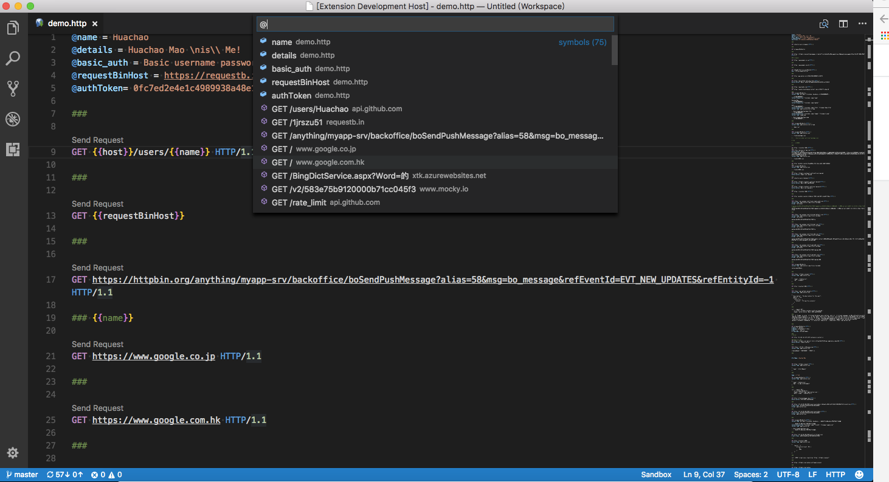

## Main Features

REST Client CE includes a rich set of features designed to make API testing convenient and efficient.

### HTTP Request Operations

- **Send/Cancel/Rerun** HTTP requests directly in the editor
- View responses in a separate pane with syntax highlighting
- Support for all standard HTTP methods (GET, POST, PUT, DELETE, PATCH, etc.)
- Multiple requests in a single file separated by `###` delimiter
- Select specific text to send only that portion as a request

### GraphQL Support

- Send GraphQL queries using request body
- Author GraphQL variables in the request body
- Separate GraphQL query and variables with a blank line
- Set `X-Request-Type: GraphQL` header to identify as GraphQL request

### cURL Integration

- Send cURL commands directly in the editor
- Copy HTTP requests as cURL commands (`Rest Client: Copy Request As cURL`)
- Supported cURL options:
    - `-X, --request`
    - `-L, --location, --url`
    - `-H, --header` (no `@` support)
    - `-I, --head`
    - `-b, --cookie` (no cookie jar file support)
    - `-u, --user` (Basic auth only)
    - `-d, --data, --data-ascii, --data-binary, --data-raw`

### Copy Request As cURL

If you need to quickly obtain the curl format of an HTTP request and save it to your clipboard, you can use a handy shortcut. Simply hit `F1` and select/type `Rest Client: Copy Request As cURL`. Alternatively, you can right-click in the editor and select `Copy Request As cURL.`

### Cancel Request

If you want to cancel a processing request, click the waiting spin icon or use shortcut `Ctrl+Alt+K`(`Cmd+Alt+K` for macOS), or press `F1` and then select/type `Rest Client: Cancel Request`.

### Rerun Last Request

Sometimes you may want to refresh the API response, now you could do it simply using shortcut `Ctrl+Alt+L`(`Cmd+Alt+L` for macOS), or press `F1` and then select/type `Rest Client: Rerun Last Request` to rerun the last request.

### Request History

- Auto-save every sent request to history
- View last 50 requests via `Ctrl+Alt+H` (`Cmd+Alt+H` on macOS)
- Display method, URL, and request time for each entry
- Re-send any historical request by selecting it
- Clear history via `Rest Client: Clear Request History`

### Response Handling

- Save full response (headers + body) to file
- Save response body only with appropriate file extension based on MIME type
- Fold/unfold response body for easier navigation
- Preview response in different modes:
    - **Full**: complete response with headers and body
    - **Headers**: headers only
    - **Body**: body only
    - **Exchange**: both request and response
- View images directly in the preview pane
- Customize font size, family, and weight for response preview
- Copy response body to clipboard

### Customization & Productivity

- Generate code snippets in multiple languages (Python, JavaScript, cURL, etc.)
- Remember cookies for subsequent requests (configurable)
- Add notes and per-request settings
- CodeLens support for quick "Send Request" action
- Keyboard shortcuts for all common operations
- Support for SOAP requests with envelope snippets

### Authentication Methods

REST Client CE supports multiple authentication schemes:

- **Basic Auth** - Username/password with base64 encoding
- **Digest Auth** - More secure challenge-response authentication
- **SSL Client Certificates** - PFX, PKCS12, and PEM formats
- **Microsoft Entra ID (ex Azure Active Directory)** - Enterprise cloud directory
- **OpenID Connect** - OAuth2 with incremental consent
- **AWS Signature v4** - AWS service authentication
- **AWS Cognito** - AWS user pool authentication

### Environments & Variables

- Create multiple environments (development, staging, production)
- **Shared environment** (`$shared`) for common variables
- Switch environments via `Ctrl+Alt+E` (`Cmd+Alt+E` on macOS)
- Four variable types:
    - **Environment variables** - Shared across files
    - **File variables** - Scoped to the current file
    - **Request variables** - For request chaining
    - **Prompt variables** - Interactive input per request
- System variables for dynamic values (GUIDs, timestamps, random numbers, etc.)
- Variable auto-completion and hover support
- Go to definition for variables
- Find all references for file variables

### HTTP Language Support

Full language support for `.http` and `.rest` files:

- Syntax highlighting for requests and responses
- Auto-completion for methods, URLs, headers, variables, MIME types
- Code snippets for common operations (GET, POST, etc.)
- Comment support (`#` and `//`)
- JSON/XML body indentation and auto-closing brackets
- Goto symbol definition (`Ctrl+Shift+O` / `Cmd+Shift+O`)
- CodeLens for sending requests
- Request block folding/unfolding
- Support for Markdown fenced code blocks with `http` or `rest`

#### Auto Completion

Currently, auto completion will be enabled for following seven categories:

1. HTTP Method
2. HTTP URL from request history
3. HTTP Header
4. System variables
5. Custom variables in current environment/file/request
6. MIME Types for `Accept` and `Content-Type` headers
7. Authentication scheme for `Basic` and `Digest`

#### Navigate to Symbols in Request File

A single `http` file may define lots of requests and file level custom variables, it will be difficult to find the request/variable you want. We leverage from the _Goto Symbol Feature_ of _Visual Studio Code_ to support to navigate(goto) to request/variable with shortcut `Ctrl+Shift+O`(`Cmd+Shift+O` for macOS), or simply press `F1`, type `@`.

### Proxy & Network

- Respects VS Code proxy settings (`http.proxy`, `http.proxyStrictSSL`)
- Support for HTTP and HTTPS proxies
- Exclude specific hosts from proxy via `rest-client.excludeHostsForProxy`
- Configurable timeout (0 for infinity)

### File Support

- Use file contents as request body with `< path/to/file`
- Variable processing in referenced files with `@` prefix
- Encoding override for file references
- Support for multipart/form-data with file uploads
- Support for application/x-www-form-urlencoded format
- Clickable document links (Ctrl/Cmd + Click) to open files

### Streaming (+72)

`text/event-stream` — how every AI API answers in 2026 — is painted in the response panel **as it arrives**. Cancel keeps what came in. `sse.count`, `sse.first` and `sse.last` can be asserted.

`WEBSOCKET wss://host/socket` with the JetBrains syntax: messages in the body separated by `===`, `# @timeout 3000` to say how long to listen, and a transcript (`>>` sent, `<<` received) as the response.
